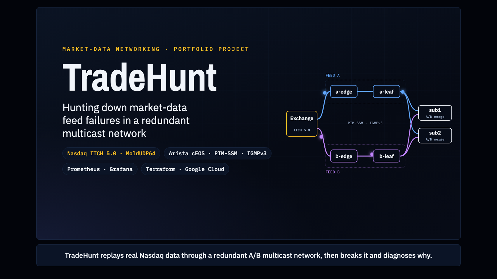

# TradeHunt

[](https://jeevanandh32.github.io/tradehunt-demo.html)

**▶ [Watch the 2-minute demo](https://jeevanandh32.github.io/tradehunt-demo.html)** (or [download the MP4](docs/tradehunt-demo.mp4))

*Hunting down market-data feed failures in a redundant multicast network.*

A lab that rebuilds how stock exchanges deliver market data to trading firms, replays **real Nasdaq data** through it, breaks it in realistic ways, and diagnoses each failure the way a market-data support engineer would.

> Lab project. Data comes from Nasdaq's public TotalView-ITCH 5.0 sample files. Status: **complete**. All 6 incidents are built, diagnosed and documented (see [RESULTS.md](RESULTS.md)).

---

## The problem in one paragraph

Exchanges publish market data over **multicast**, on two identical feeds (**A** and **B**) carried by separate networks. A trading firm listens to both and keeps whichever copy of each message arrives first (**A/B arbitration**). If one feed drops a packet, the other fills the hole. That safety net also hides failures: **one feed can quietly die** and nobody notices until the second one fails. When a client says "no data", "gaps at the open" or "it stopped after a change", a support engineer has to find the cause fast.

## How it works

```
                 ┌──── A NETWORK (10.1.0.0/16) ────┐
            ┌──► │  a-edge ─────────── a-leaf      │ ──┐
 ┌────────┐ │    └─────────────────────────────────┘   │   ┌──────┐
 │EXCHANGE│─┤        OSPF · PIM-SSM · IGMPv3           ├──►│ sub1 │  trading servers,
 └────────┘ │    ┌─────────────────────────────────┐   ├──►│ sub2 │  each on BOTH feeds
            └──► │  b-edge ─────────── b-leaf      │ ──┘   └──────┘
                 └──── B NETWORK (10.2.0.0/16) ────┘
   publisher + retransmitter          4 × Arista cEOS          feed handler on each server
                                                     Prometheus + Grafana watch the handlers
```

1. **Publisher** (exchange) reads real Nasdaq ITCH messages, packs them into **MoldUDP64** packets with sequence numbers, and sends every packet on **both** feeds.
2. **Switches** carry the traffic by multicast. Servers join with IGMPv3, and PIM-SSM builds the path back to the source.
3. **Feed handler** (each server) merges A and B, spots missing sequence numbers, and asks the **retransmitter** for anything missing on both.
4. **Prometheus and Grafana** show each feed's health and alert when one side goes silent.
5. **`tradehunt diagnose`** checks the feeds, walks the path back to the source, and names the root cause.

## Folder map

| Folder | What's inside |
|---|---|
| `feed/` | The market-data programs (Python, standard library only) |
| `feed/moldudp64.py` | Packet format and feed plan (groups, ports, sources) shared by everything |
| `feed/itchreplay.py` | Turns the Nasdaq file into numbered MoldUDP64 packets |
| `feed/publisher.py` | The exchange: replays the data on feeds A and B |
| `feed/retransmitter.py` | The exchange's resend service for missing messages |
| `feed/handler.py` | The trading server: A/B arbitration, gap recovery, metrics |
| `feed/report.py` | One-line summaries of publisher and handler results |
| `tools/tradehunt.py` | The diagnostic tool |
| `lab/` | The network and the scripts that drive it |
| `lab/tradehunt.clab.yml` | Topology: 4 switches, exchange, 2 servers, Prometheus, Grafana |
| `lab/configs/` | Arista switch configs, one per switch |
| `lab/deploy.sh` | Builds and starts the whole lab (about 70 s) |
| `lab/feeds.sh` | Starts, stops or checks the feed programs |
| `lab/feed-test.sh` | Replay test: clean, loss on one feed, loss on both |
| `lab/incident.sh` | Injects or fixes an incident |
| `lab/blind-run.sh` | Random incidents, diagnosed and scored automatically |
| `DEMO.md` | Script for a 3-minute demo video |
| `docs/` | Cover image and the 2-minute demo video |
| `monitoring/` | Prometheus scrape config and alert rules, Grafana dashboard |
| `kb/` | One support-style knowledgebase article per incident |
| `terraform/` | The Google Cloud VM that hosts the lab |
| `data/` | The Nasdaq data slice (local only, not committed) |

## Incidents

| # | Client says | Root cause | Status |
|---|---|---|---|
| 1 | "No data at all" | Publisher multicast TTL = 1 | ✅ Built and diagnosed |
| 2 | "No feed B on one server" | Linux `rp_filter` | ✅ Built and diagnosed |
| 3 | "Feed A stopped for the whole VLAN" | No IGMP querier/router on the VLAN | ✅ Built and diagnosed |
| 4 | "Stopped after a routing change" | RPF broken by a leftover blackhole route | ✅ Built and diagnosed |
| 5 | "Gaps at the open on one server" | Socket receive buffer too small for the burst | ✅ Built and diagnosed |
| 6 | *(nobody noticed)* | Feed A silently dead (uplink down), hidden by arbitration | ✅ Built and diagnosed |

## Results

| What | Result |
|---|---|
| Market open replayed (peak 698K msgs/s in the data) at 1/10 speed | 2,440,699 messages, **0 gaps** on both feeds |
| 2% loss on both feeds | All 873,273 messages delivered, **268 recovered** by retransmission, **0 lost** |
| Feed A cut | Alert in **6.1–7.0 s**, while servers lost nothing |
| Socket buffer at the open | 4 KB: ~8,000 kernel drops per server; 4 MB: **0** |
| Diagnostic tool, blind runs | **18 of 18** correct root causes, covering all 6 incidents |
| Lab limit (software switches) | About 2,000 packets/s per feed, so replays run at 0.1× |

All numbers and how they were measured are in [RESULTS.md](RESULTS.md).

## Running it

Everything runs on the GCP VM (`terraform/`). The Mac only edits code and copies it over.

```bash
# from the Mac
gcloud compute instances start tradehunt-lab --zone us-east4-a --project tradehunt-2611
gcloud compute ssh tradehunt-lab --zone us-east4-a --project tradehunt-2611 --tunnel-through-iap

# on the VM
~/tradehunt/lab/deploy.sh                        # build the lab (needed after every VM start)
~/tradehunt/lab/feeds.sh start                   # replay real data continuously
sudo python3 ~/tradehunt/tools/tradehunt.py diagnose
~/tradehunt/lab/incident.sh inject 2             # break something ...
sudo python3 ~/tradehunt/tools/tradehunt.py diagnose
~/tradehunt/lab/incident.sh fix 2                # ... and fix it

# Grafana: open a tunnel from the Mac, then browse to http://localhost:3000
gcloud compute ssh tradehunt-lab --zone us-east4-a --project tradehunt-2611 --tunnel-through-iap -- -L 3000:localhost:3000

# stop paying for the VM when done
gcloud compute instances stop tradehunt-lab --zone us-east4-a --project tradehunt-2611
```
